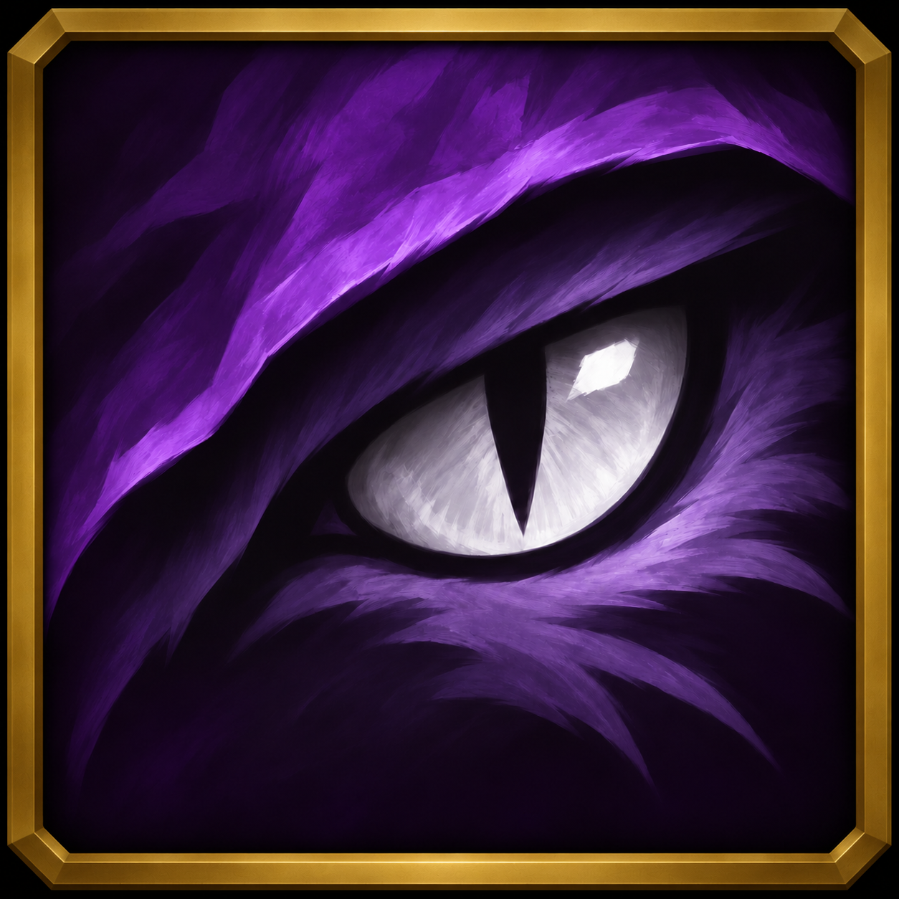

# AggeStealthBar

Native stealth and prowl action-bar paging for **WoW Forever**.



- Rogue Stealth and druid Cat Form + Prowl, in one addon.
- Uses the actual Blizzard main-bar buttons and artwork, with their native clicks, pickup modifier, keybindings, tooltips and cooldowns.
- Secure paging designed to work in combat; preferences changed during combat apply afterward.
- Blizzard-style settings, optional minimap button and startup message, matching AggeHealBot and AggeMinimap.
- Optional smooth stealth transitions: a brief shadow fade and violet edge glow, with immediate action switching.

Type **`/asb`** or open **Options → AddOns → AggeStealthBar** for settings. Click the minimap button to toggle the settings window.

For **Forever 1.60.1** only. **0.1.4 is a test build, pending full in-game verification.** Use Blizzard's keyboard/mouse action bars and one main-bar paging addon at a time. Gamepad bars and third-party replacement bars are outside this version's scope.

Enter Stealth, or Cat Form and Prowl, and drag spells onto the main bar. Rogue uses page **7** (slots 73–84); druid uses page **8** (slots 85–96). These are existing WoW action slots, not separate addon storage. Existing actions on those pages remain in place. Leaving stealth restores the native parent page; manually selected pages and other forms retain native paging. Blizzard saves the spells; the addon saves only preferences per character. Disabling the addon restores parent-page inheritance without moving any spells.

With locked bars, hold your pickup modifier (normally **Shift**) to drag actions. AggeStealthBar leaves Blizzard's click and drag handlers and the game-wide action-button key-down setting untouched.

[Report an issue](https://github.com/arwebSE/AggeStealthBar/issues) · [AggeHealBot](https://www.curseforge.com/wow/addons/aggehealbot) · [AggeMinimap](https://www.curseforge.com/wow/addons/aggeminimap)

<details>
<summary>Manual installation</summary>

Extract the release ZIP into your Forever client's `Interface/AddOns` folder. The resulting path must be `Interface/AddOns/AggeStealthBar/AggeStealthBar.toc`. Restart the game after first installation.

</details>

<details>
<summary>Development and verification</summary>

```powershell
uv run --with lupa python tests/check.py
./scripts/package.ps1
```

Tests compile every Lua file with Lua 5.1 and simulate rogue/druid paging, parent-page changes, combat preference deferral, disabling, form-index changes and initial conflicts. Simulation does not establish Blizzard combat security, exact rendering or live API compatibility. Complete [in-game checks](docs/TESTING.md) before publishing. [Release preparation](docs/RELEASING.md) includes the CurseForge checklist.

Original addon logic; no source copied from competing stealth-bar addons. The unmodified libraries are the same LibStub, CallbackHandler, LibDataBroker and LibDBIcon snapshot bundled with AggeHealBot; see [library notices](AggeStealthBar/Libs/NOTICE.txt).

</details>

[MIT license](LICENSE), except bundled libraries under their own terms.
